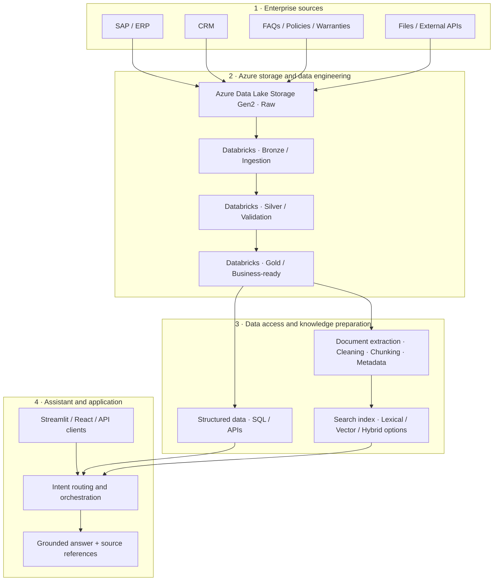
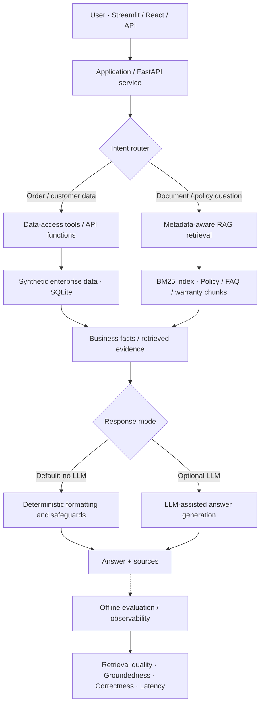

# Enterprise Omni-Channel AI Assistant

**Enterprise AI Engineering · RAG · Agentic Routing · Azure / Databricks · FastAPI · React**

An end-to-end AI engineering portfolio project exploring how an enterprise assistant can answer customer-service questions using **structured ERP/CRM data**, **business documents**, and **optional LLM generation**. The project combines a cloud-oriented data architecture with a lightweight, reproducible local demonstration.

**[Live Streamlit demo](https://enterprise-omnichannel-ai.streamlit.app)** · **[Source repository](https://github.com/cartelleF/enterprise-omnichannel-ai-assistant)**

> **Implementation transparency:** The public demo does **not** require active Azure or Databricks resources. Azure/Databricks pipelines and GPT-OSS-20B were explored during cloud development; the local runtime uses synthetic data and deterministic responses by default. LLM generation is optional, not required for the demo.

## 1. Business challenge

Customer-service knowledge is fragmented across ERP systems, CRMs, operational databases, FAQs, product warranties, and policy documents. A useful enterprise assistant must choose the appropriate source, retrieve relevant evidence, avoid unsupported claims, and expose results through applications and APIs. It must also be testable, observable, secure, and cost-aware.

This project demonstrates the engineering building blocks for that workflow, using **synthetic** business data rather than customer records.

## 2. Architecture at a glance

### A. Enterprise data and AI architecture — cloud reference and development work



**Reading this diagram:** It illustrates the enterprise-oriented data flow and the separation of structured data from document knowledge. It is **not** a claim that the entire cloud stack is deployed and running in the public demo. The vector/hybrid-search branch represents an architectural extension; the current local demo uses BM25.

### B. Request processing — actual local behavior and optional LLM path



The **intent router** selects a workflow. Tool execution can query structured data; RAG retrieves document evidence. **Tool calling and RAG are alternative or composable paths**, not necessarily sequential steps. Retrieved evidence can be formatted directly or passed to an optional LLM. Retrieval metrics are evaluated at the retrieval stage; groundedness and answer correctness apply to the resulting answer. Evaluation is primarily a testing/observability activity, not a mandatory extra step before every user response.

## 3. Execution modes and model selection

| Mode | Retrieval / data | Answer generation | Intended use |
|---|---|---|---|
| **Local (default)** | Synthetic SQLite data; local metadata-filtered BM25 | Deterministic, source-based formatting | Cost-free, reproducible demonstration |
| **Local AI (optional)** | Local enterprise data and RAG | LLM-assisted generation, subject to usage controls | Demonstrate optional generative responses |
| **Azure / Databricks development** | Azure Data Lake and Databricks workflows | GPT-OSS-20B used during cloud experimentation | Explore enterprise data/AI integration and model trade-offs |

### GPT-OSS-20B and cost-aware design

During the Azure development phase, **GPT-OSS-20B** was used for LLM-assisted responses. The model was chosen with **cost and latency** in mind while retaining useful natural-language generation capabilities. This was a practical model-selection trade-off, not a published head-to-head benchmark against other models.

Cloud experimentation also highlighted the importance of cost governance: **managed compute, storage, and inference can all incur charges**. The project therefore separates its cloud reference architecture from a local public demo that does not depend on continuously running paid services.

The optional LLM demonstration was developed with a **five-calls-per-day usage limit**. The exact enforcement scope and configuration should be verified in the deployment before treating this as a security or billing guarantee. The deterministic mode makes **no external LLM inference calls**.

## 4. Features

- **Intent-based orchestration:** Routes order/customer lookups and knowledge questions to the appropriate path.
- **Structured business queries:** Reads synthetic enterprise records through a local data-access layer.
- **Metadata-aware document retrieval:** Uses `topic` filters (`RETURN`, `DELIVERY`, `WARRANTY`) and product IDs such as `PROD-1001`.
- **Optimized local BM25:** Precomputes term frequencies at index construction to reduce repeated scoring work.
- **Grounded deterministic answers:** Returns evidence-based text with document source references, without relying on an LLM.
- **Warranty clarification:** A general warranty question prompts for a product identifier when retrieved evidence consists only of product-specific warranties.
- **Multilingual work:** Includes English, French, and German retrieval scenarios and related evaluation components.
- **Application interfaces:** FastAPI backend, React frontend, and public Streamlit demo.
- **Operational controls:** Request rate limiting, timing instrumentation, tests, and optional LLM usage limits.

### Example questions

```text
What is the return policy?
What is the warranty for PROD-1001?
What is the warranty policy?
What is the status of order ORD-10066?
Quelle est la politique de retour ?
Wie funktioniert die Lieferung?
```

The general warranty question is deliberately treated differently from the product-specific question: the assistant should not present one product's warranty as a universal company policy.

## 5. Data engineering and enterprise design

The repository explores an Azure-oriented **medallion architecture**:

1. **Raw / Bronze:** Ingest source records with provenance and ingestion metadata.
2. **Silver:** Clean and standardize records; validate data types and business constraints.
3. **Gold:** Prepare curated data for analytics, operational questions, and AI use cases.
4. **AI access:** Expose structured business data via tools/APIs and unstructured knowledge through document processing and retrieval.

Cloud development used **Azure Data Lake Storage Gen2**, **Azure Databricks**, and an identity-oriented storage access design involving **Unity Catalog, an Access Connector, Managed Identity, and Azure RBAC**. This is separate from the lightweight local execution path; the public demo must not be interpreted as running Databricks in the background.

## 6. Evaluation and performance

Evaluation work in the project covers several complementary dimensions:

| Layer | What is evaluated |
|---|---|
| Retrieval | Precision@K, Recall@K, MRR and relevant-document selection |
| Generation | Source alignment, groundedness, answer correctness and unsupported claims |
| Orchestration | Routing decisions, tool execution and task outcomes |
| Multilingual | Retrieval behavior for English, French and German queries |
| Runtime | Retrieval latency, component timings and regression tests |

**Latest verified local test run:** `332 passed` (6.75 s), following the general-warranty clarification change.

### BM25 microbenchmark

A local benchmark using **15 indexed chunks** and repeated sets of three questions observed:

| Metric (three-query batch) | Before | After |
|---|---:|---:|
| Mean | 0.2819 ms | 0.1075 ms |
| Median | 0.2456 ms | 0.1071 ms |

This is an **approximately 61.9% reduction in observed mean scoring time** for that small local workload, **not** a production end-to-end latency claim. The benchmark preserved the observed top-three rankings for the tested questions. The actual assistant additionally applies metadata filters, which are essential for relevance.

> Evaluation code and benchmark results should be interpreted in the context of their test datasets. Module availability alone does not establish production-level accuracy or safety.

## 7. Local setup

### Prerequisites

- Python 3.13-compatible environment
- Node.js and npm for the React frontend
- Git

### Clone and install

```bash
git clone https://github.com/cartelleF/enterprise-omnichannel-ai-assistant.git
cd enterprise-omnichannel-ai-assistant
python3 -m venv .venv
source .venv/bin/activate
python -m pip install -r requirements.txt
```

### Run the Python test suite

```bash
python -m pytest -q
```

### Frontend dependencies and production build

```bash
cd frontend
npm install
npm run build
```

### Run the demo applications

The project includes a Streamlit application and a FastAPI application. **Check the actual entry-point paths and environment configuration in the repository before running the services**; the deployment-specific startup commands should be documented here once verified against the current tree. The default local backend is designed to work without cloud credentials.

For the optional AI mode, configure the relevant model credentials through environment variables; **never commit credentials or `.env` files**.

## 8. Security, limitations, and responsible claims

- All showcased SAP/CRM-style records are **synthetic**.
- Local deterministic mode is designed to operate **without external LLM calls**.
- Source references support traceability but do not, by themselves, guarantee factual correctness.
- Metadata filtering improves relevance; it is **not** a substitute for authorization controls.
- Rate limiting and an LLM daily-call quota are **cost/abuse controls**, not full enterprise security.
- The public demo is **not** presented as a production SAP/CRM integration or a live Azure/Databricks deployment.
- Production deployment would require identity and access management, secrets handling, data governance, auditability, monitoring, and additional security/evaluation controls.

## 9. Engineering decisions

| Decision | Rationale |
|---|---|
| Local deterministic default | Reproducibility, transparency, zero mandatory inference cost |
| Optional LLM generation | Demonstrate richer language generation without making it a runtime dependency |
| Metadata filtering before BM25 ranking | Preserve business relevance for return, delivery, and product-specific warranty questions |
| Precomputed BM25 term frequencies | Avoid repeated work during retrieval scoring |
| Azure/Databricks as a separate cloud-oriented path | Demonstrate scalable enterprise design while keeping the public demo inexpensive |
| Automated regression tests | Protect routing, retrieval, formatting, and API behavior during iteration |

## 10. Project scope

This is an **independent portfolio project** demonstrating practical design choices across **Data Engineering, RAG, LLM integration, orchestration, API development, evaluation, and cost-aware deployment**. It intentionally distinguishes between **implemented local behavior**, **cloud development experience**, and **future enterprise deployment requirements**.
